<picture>
  <source media="(prefers-color-scheme: dark)" srcset="assets/header-dark.svg" />
  <source media="(prefers-color-scheme: light)" srcset="assets/header-light.svg" />
  
</picture>

 

hey, I'm washi. I work on post-training data for RL, the stuff frontier models learn from.
if AI labs are the jet engines, the data is the crude oil. I guess you can say I'm in the oil business.

ex-blackrock.

 

<picture>
  <source media="(prefers-color-scheme: dark)" srcset="assets/label-work-dark.svg" />
  <source media="(prefers-color-scheme: light)" srcset="assets/label-work-light.svg" />
  
</picture>

<picture>
  <source media="(prefers-color-scheme: dark)" srcset="assets/lookbook-dark.svg" />
  <source media="(prefers-color-scheme: light)" srcset="assets/lookbook-light.svg" />
  
</picture>

[paperMD](https://github.com/NeonNova/paperMD) &nbsp;/&nbsp; [l'ardoise](https://github.com/NeonNova/lardoise) &nbsp;/&nbsp; [typify](https://github.com/NeonNova/typify) &nbsp;/&nbsp; the rice private

  

<picture>
  <source media="(prefers-color-scheme: dark)" srcset="assets/label-ledger-dark.svg" />
  <source media="(prefers-color-scheme: light)" srcset="assets/label-ledger-light.svg" />
  
</picture>

<picture>
  <source media="(prefers-color-scheme: dark)" srcset="https://raw.githubusercontent.com/NeonNova/NeonNova/output/ledger-dark.svg" />
  <source media="(prefers-color-scheme: light)" srcset="https://raw.githubusercontent.com/NeonNova/NeonNova/output/ledger-light.svg" />
  
</picture>

  

<picture>
  <source media="(prefers-color-scheme: dark)" srcset="assets/label-activity-dark.svg" />
  <source media="(prefers-color-scheme: light)" srcset="assets/label-activity-light.svg" />
  
</picture>

<picture>
  <source media="(prefers-color-scheme: dark)" srcset="https://raw.githubusercontent.com/NeonNova/NeonNova/output/contrib-dark.svg" />
  <source media="(prefers-color-scheme: light)" srcset="https://raw.githubusercontent.com/NeonNova/NeonNova/output/contrib-light.svg" />
  
</picture>

  

<picture>
  <source media="(prefers-color-scheme: dark)" srcset="assets/label-kit-dark.svg" />
  <source media="(prefers-color-scheme: light)" srcset="assets/label-kit-light.svg" />
  
</picture>

<picture>
  <source media="(prefers-color-scheme: dark)" srcset="assets/kit-dark.svg" />
  <source media="(prefers-color-scheme: light)" srcset="assets/kit-light.svg" />
  
</picture>

 

<picture>
  <source media="(prefers-color-scheme: dark)" srcset="assets/footer-dark.svg" />
  <source media="(prefers-color-scheme: light)" srcset="assets/footer-light.svg" />
  
</picture>

[mail](mailto:adityawashikar@gmail.com) &nbsp;/&nbsp; [linkedin](https://www.linkedin.com/in/adityawashikar)
